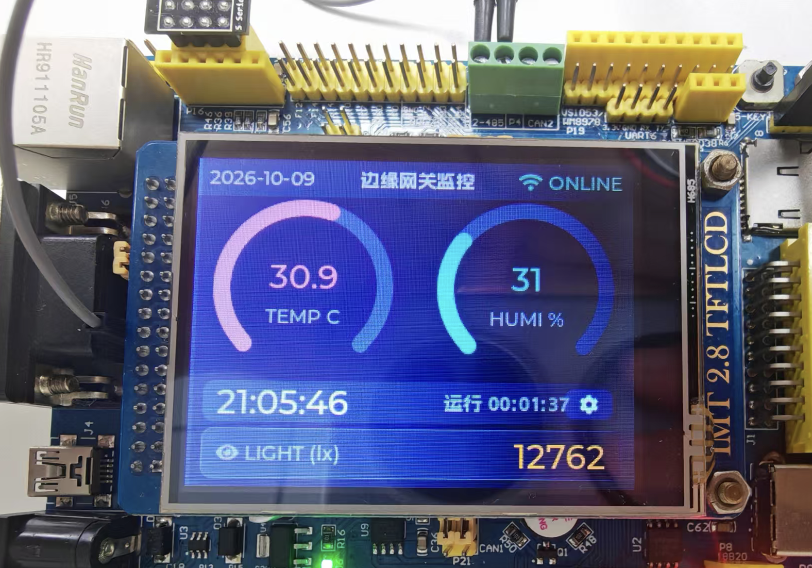

# industrial-edge-gateway（STM32F407ZGT6 移植版）

工业边缘网关（FreeRTOS + LVGL 8.3）：Modbus RTU 从机采集 → RS485、ESP8266 上云 MQTT（IOTSystem / OneNET，profile 切换）、W25Q128 断网缓存与系统日志、看门狗、LVGL 触摸界面。
原项目为 STM32F411 + SPI 屏，本工程已完整移植到 **启明欣欣 STM32F407ZGT6 高配版 V4.1 + 2.8 寸 ILI9341 并口屏（XPT2046 触摸）**。

- CubeMX 工程：`industrial-edge-gateway.ioc`（CubeMX 6.18.1 / FW_F4 V1.28.3，工具链 CMake+GCC）
- 配套从机板：`ModbusSlave/`（第二块 F407 板模拟 0x01 温湿度[DHT11 实测] / 0x02 光照[PF3 ADC] 两台 Modbus 从机）
- 资源占用（网关，Debug 构建实测）：Flash ≈441KB / 1MB（42%），RAM ≈114KB / 128KB（87%）；从机：Flash 27KB，RAM 2.5KB



## 使用方法（CubeMX / VS Code）

1. 使用 STM32CubeMX 导入 `industrial-edge-gateway.ioc`，CubeMX 版本为 6.18.1。
2. 点击 "Generate Code"，基于 CMake 生成工程。根据你使用的编辑器选择对应的 Toolchain，默认是 CMake + GCC。
3. 配置 VS Code 运行工程：安装最新版 VS Code，并安装 [STM32CubeMX 扩展](https://marketplace.visualstudio.com/items?itemName=stmicroelectronics.stm32-vscode-extension)。
4. 根据右下角提示进行配置，通常一路点击"是"即可。烧录时，使用 Debug 模式并创建 `launch.json` 文件。

> 注意：CubeMX 重新生成代码后，核对 `Core/Src/stm32f4xx_it.c` 里的 `TIM4_IRQHandler` 是否还在（HAL 时基，丢失=开机死机）。

## 云端凭据配置（.env）

固件源码不含任何云端密钥：真实凭据写在仓库根目录的 **`.env`**（已被 `.gitignore` 忽略、不入库），CMake 配置时逐行解析并以编译宏注入，覆盖 `User/net/cloud.h` 里的占位默认值。

```bash
cp .env.example .env   # ① 复制模板
vim .env               # ② 按下文填写真实凭据（切平台只改 CLOUD_TARGET 一行）
make                   # ③ 正常构建，配置期自动注入（日志打印每个 KEY 的来源）
```

没有 `.env` 时使用 cloud.h 的占位值，设备连不上平台（CONNACK 被拒），属预期行为。

### OneNET（默认）

1. 在 [OneNET Studio](https://studio.onenet.net/) 控制台创建产品与设备，记下**产品 ID**、**设备名称**和**设备密钥**。
2. 打开在线工具 **[OneNET MQTT 参数生成](https://embedkit.ryanuo.cc/zh/tools/onenet-mqtt)**：填入产品 ID、设备名称、设备密钥（Base64），选择签名算法与有效期，即可生成 `version=...&res=...&et=...&method=sha1&sign=...` 格式的鉴权 token。计算全部在浏览器本地完成，密钥不上传服务器。
3. 填入 `.env`：

```
CLOUD_TARGET=CLOUD_ONENET
ONENET_HOST=mqtts.heclouds.com
ONENET_PRODUCT_ID=<产品ID>     # 即 MQTT username
ONENET_DEVICE_ID=<设备名称>    # 即 MQTT clientID
ONENET_TOKEN=<工具生成的 token>
```

> token 中 `et=` 是过期时间戳，到期后设备全部掉线，需重新生成并更新 `.env`。

### IOTSystem（自建）

开源自建 IoT 设备管理平台（C + libevent + MySQL，自带 MQTT Broker，支持数据采集/告警/设备影子/指令下发），部署与设备注册见 **[Lab0x-Embedded/iotsystem](https://github.com/Lab0x-Embedded/iotsystem)**：

```bash
git clone https://github.com/Lab0x-Embedded/iotsystem
cp deploy/config.example.json deploy/config.json    # 填数据库密码
make db_init && make build && make server           # MQTT 1883 / HTTP 8080
```

在平台注册产品与设备后，把凭证填入 `.env`（对应 MQTT 认证：username=product_key、password=device_secret）：

```
CLOUD_TARGET=CLOUD_IOTSYSTEM
IOTSYSTEM_HOST=<平台地址>           # 如 192.168.0.49（MQTT 端口 1883）
IOTSYSTEM_PRODUCT_KEY=<product key>
IOTSYSTEM_DEVICE_ID=<device id>
IOTSYSTEM_DEVICE_SECRET=<device secret>
```

## 目录结构

```
Core/                  CubeMX 生成（时钟168M、FSMC、UART4+DMA、USART2、UART5调试、SPI1、TIM3、TIM4时基、RTC、IWDG、FreeRTOS）
User/
  app/                 业务任务调度（tasks.c，原 Taskhandel）、时间服务（clock.c：单调 tick 走时 + RTC/编译时间定初值）
  bsp/                 板级驱动：lcd.c（FSMC 并口 ILI9341）、touch.c（XPT2046 + 两点校准）
  modbus/              Modbus RTU 主站（USART2 PA2/PA3 9600，方向脚 PG6；数据有效性门控）
  net/                 cloud.c（云平台 profile 层：E2/OneNET）、wifi_conn.c（入网/凭据/热点扫描/SNTP 校时）、esp_at.c（AT 驱动）、esp_uart.c（UART4 DMA 接收环形缓冲）
  storage/             w25qxx.c（W25Q128 SPI1 PB3/4/5，CS=PG8 驱动）、log.c（日志 0~4MB）、cache.c（断网补传缓存 4~8MB）
  gui/                 LVGL 8.3（src/）、porting/（显示/触摸移植）、ui/（界面页面 + ui_theme.c 色板/样式 + font_cjk_14.c 中文字体）、lv_conf.h
ModbusSlave/           从机固件（独立 CMake 工程）：DHT11=PA15、光敏=PF3(ADC3_IN9)、RS485 从机 0x01/0x02
tools/                 modbus_sim.py（PC 模拟从机）、modbus_master_test.py（PC 当主机直测从机板）
docs/                  系统架构图（mermaid）、调试排查手册（18 个实战案例）
Makefile               make build / slave / flash / flash-slave / size ...（封装 CMake preset）
```

## 构建（macOS，GCC）

```bash
make            # 网关固件（= cmake --preset Debug && cmake --build --preset Debug）
make slave      # 从机固件（独立构建目录 ModbusSlave/build/）
make size       # 网关 Flash/RAM 占用；make size-slave 同理
```

工具链用 STM32Cube 自带 GNU Tools（`cmake/gcc-arm-none-eabi.cmake` 已指向），Homebrew 的 arm-none-eabi-gcc 缺 newlib 不可用。
**Makefile 目前仅支持 macOS**：工具链路径写死了 macOS 的 STM32Cube bundle 位置（`~/Library/Application Support/stm32cube/...`），Windows/Linux 需改 `cmake/gcc-arm-none-eabi.cmake` 里的 `ST_TOOLCHAIN_DIR` 和 Makefile 的 `CUBE_BIN`。
**注意**：必须走 `cmake --preset`（工具链在 preset 里）；手工 `cmake -S . -B build` 会在 build 阶段报 startup 文件语法错误。

## 烧录

```bash
make flash                       # 网关（openocd + ST-Link，可换 FLASH_TOOL=pyocd 等）
make flash-slave                 # 从机板（ST-Link 换接从机 SWD 后）
make reset / make openocd        # 复位 / 起 gdbserver
```

- 也可用 STM32CubeProgrammer / Keil / VS Code 调试配置，应用代码都在 USER CODE 区和 User/ 目录，不会丢。
- 调试串口：**UART5 = PC12(TX)/PD2(RX)，115200**（CH340 USB-TTL），输出联网阶段、日志镜像、OneNET 回执。

## 上报格式与数据门控

- 上报格式：IOTSystem = `devices/<id>/data` datapoints JSON；OneNET = `$sys/{pid}/{dev}/thing/property/post` 物模型包装格式。
- **数据有效性门控**：某设备从未成功读到过数据时，其字段不会出现在 payload 里（全 0 假数据不上云、不进断网缓存）。

## 引脚对照（启明欣欣 V4.1）

| 功能 | 引脚 |
|---|---|
| LCD FSMC 16 位并口 | NE4=PG12，RS=A12=PG2，NOE=PD4，NWE=PD5，D0~D15=PD14/15、PD0/1、PD8/9/10、PE7~PE15 |
| LCD 背光 | PF10（高=亮） |
| XPT2046 触摸 | CLK=PA5，MOSI=PB1，MISO=PB2，CS=PB0，PEN=PF11（低=按下）|
| ESP8266（WIFI 座） | UART4：TX=PA0，RX=PA1，115200；RX=DMA1_Stream2，TX=DMA1_Stream4 |
| RS485 | USART2：PA2/PA3，9600；方向 PG6（高发低收） |
| W25Q128 | SPI1：PB3/4/5，CS=PG8；**总容量 16MB**：日志 0~4MB、补传缓存 4~8MB、触摸校准参数 0xF00000，其余空闲 |
| 指示灯 | LED0=PE3（在线实时发布）、LED1=PE4（离线存储/判离线）、LED2=PG9（补传），**低电平点亮**，详见 [docs/指示灯.md](./docs/指示灯.md) |
| LVGL 心跳 | TIM3 1ms 中断；HAL 时基 = TIM4（FreeRTOS 占用 SysTick，TIM4 在 CubeMX 里显示灰色属正常）|
| 调试串口 | UART5：PC12/PD2，115200 |

## 上电验证顺序

1. **开机校准**：首次上电（或 W25Q 无校准数据）自动出红十字校准——按左上、右下十字中心各一次；**按住屏幕开机可强制重新校准**（换板/换屏/漂移通用）。校准值存 W25Q 0xF00000，此后免校准。
2. 屏点亮显示主界面；10 秒无操作息屏，**触摸唤醒**（RS485 插拔本身不点亮，属正常）。
3. 串口终端（UART5 115200）看联网阶段输出与 `[LOG]` 日志镜像；屏幕"日志"页同内容。
4. 接从机板 RS485（A/A、B/B、共地）：屏幕温湿度/光照 800ms 刷新（DHT11 实测 + 光敏 ADC）；日志出现 `modbus back online`。
5. WIFI 座插 ESP8266：MQTT 连上后屏幕绿 ONLINE；断网测缓存（日志 WARN）、恢复后自动补传（每轮 ≤5 条）。

## 界面（LVGL，320x240 触摸）

| 页面 | 内容 |
|---|---|
| 主界面 | 中文标题「边缘网关监控」+ WiFi/云状态；温/湿双弧盘仪表；**实时时间 HH:MM:SS** + 运行时长 + 设置入口；光照读数（只有数值，无进度条） |
| 设置 | WiFi 配置 / 系统运行日志 / 关于设备 |
| WiFi 配置 | 一行 SSID 输入框（常驻可手输）+「WiFi 列表」按钮 → 点开**全屏模态列表**（进页/超时就自动扫描，扫描在 AT 任务里异步做、界面不卡；列表按信号强度排序、显示 dBm），点某个热点即填入 SSID 并把焦点跳到密码框 |
| 系统运行日志 | W25Q 日志倒序读取，最新置顶，INFO/WARN/ERROR 三色，时间戳是**运行时长**（`T+` 前缀，不是墙上时间） |
| 关于设备 | 固件/板卡/LVGL/Flash/云平台 + IP、运行时长、当前时间（每秒刷新） |

**实时时间从哪来**：走时基于 HAL 时基（HSE 晶振精度，不用漂移大的 LSI）；联网成功后由 ESP8266 SNTP 校一次绝对时间；板上有 VBAT 电池时 RTC 备份域做断电保持。
没校过时的钟显示为**暗色**（不假装是准的），连上云后自动变亮。
色板与控件样式统一在 `User/gui/ui/ui_theme.h`，换主题只改这一个文件；中文字体是 `ui/font_cjk_14.c`（14px 抗锯齿，含界面用到的全部汉字 + ASCII，**不含 LV_SYMBOL_* 图标字形**——图标标签必须继续用 montserrat）。
## 开源协议

本项目以 [MIT](./LICENSE) 协议开源：使用/修改/分发自由，只需保留版权声明。
第三方组件沿用其各自协议：STM32 HAL（BSD-3-Clause）、FreeRTOS（MIT）、LVGL（MIT）、CMSIS（Apache-2.0）。
