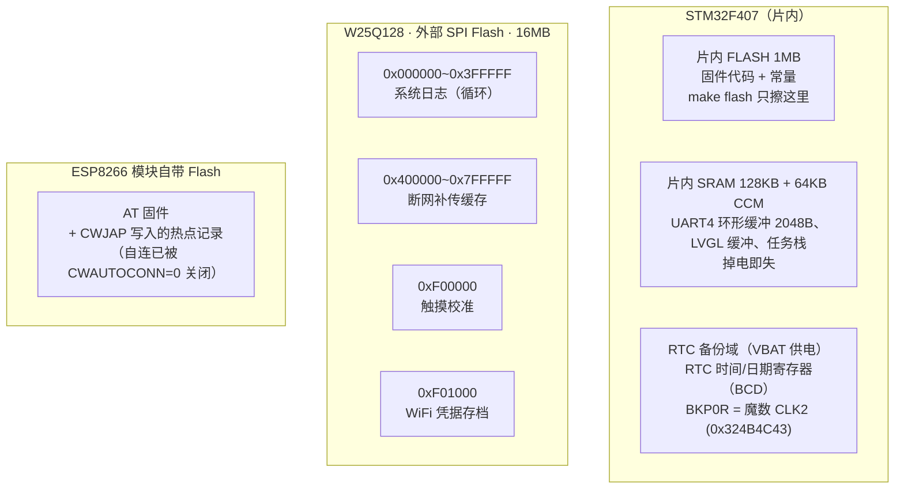

# 存储布局：内部 Flash / W25Q128 / 模块 Flash / RTC 备份域

> 本文回答"什么东西存在哪、什么格式、什么操作会动到它"。
> 代码真值源：`User/net/wifi_conn.c`、`User/storage/log.{h,c}`、`User/storage/cache.{h,c}`、`User/bsp/touch.c`、`User/app/clock.c`。
> 结论先行：**`make flash` 只擦写 MCU 内部 Flash 的程序区**，WiFi 密码、校准数据、日志、补传缓存、模块里记住的热点全都不受烧写影响。

## 总览



## W25Q128 分区图（16MB）


| 分区 | 地址范围 | 大小 | 内容 | 关键格式 |
|---|---|---|---|---|
| 系统日志 | 0x000000 ~ 0x3FFFFF | 4MB | 屏幕日志页的数据源 | 76B/条 `Log_Obj`，循环覆盖 |
| 断网补传缓存 | 0x400000 ~ 0x7FFFFF | 4MB | 断网期间的实时数据 | 128B/条 JSON，魔数标记已发 |
| 触摸校准 | 0xF00000（1 扇区） | 4KB | 两点校准坐标 | magic `TPC1` + 累加和 |
| WiFi 凭据 | 0xF01000（1 扇区） | 4KB | 设置页保存的 SSID/密码 | magic `WIFC` + 累加和 + 回读校验 |

## 各区说明

### WiFi 凭据 —— 0xF01000（你输入框里的 "YQ-shixun5" 就存这）

设置页点「保存」写入（`wifi_conn_save`），进页面由 `wifi_conn_get` 读出填进输入框：

```c
typedef struct {
    uint32_t magic;    /* "WIFC" = 0x57494643 */
    char     ssid[33];
    char     pass[65];
    uint32_t sum;      /* 全字段累加校验 */
} WifiCfg_t;
```

写完**立刻回读校验**（magic/sum/内容三项），不过则报 `wifi save verify FAIL`——W25Q 写失败是静默的，不回读就会出现"界面说保存成功、设备还在用旧凭据"。
注意：**连接成功不会更新这份存档**（它存的是"你配置了什么"，不是"最近连上了什么"）；改配置只能走设置页。

### 触摸校准 —— 0xF00000

开机两点校准的结果（左上/右下坐标）：

```c
typedef struct {
    uint32_t magic;   /* "TPC1" = 0x54504331 */
    uint16_t y_tl, x_tl, y_br, x_br;
    uint16_t sum;     /* 累加校验 */
} TPCal_t;
```

上电读出校验通过就直接用，不再弹校准流程。

### 系统日志 —— 0x000000 ~ 4MB（循环）

屏幕"日志页"的数据源，`Log_Write` 是全工程统一入口：

```c
typedef struct {
    uint32_t time_stamp;        /* HAL_GetTick() 运行滴答 */
    Log_Level level;            /* INFO=0 / WARN=1 / ERROR=2 */
    uint8_t  content[64];
    uint32_t magic;             /* 0x55AA，恰好 76 字节无填充歧义 */
} Log_Obj;                      /* 76B/条 */
```

条目不跨 4KB 扇区（进新扇区先擦除），写满 4MB 自动回卷覆盖最旧的；日志页从写指针**倒序**读，最新置顶。

### 断网补传缓存 —— 4MB ~ 8MB

断网期间 `MQTT` 任务把实时数据 JSON 顺写进来，**128B/条**，条目头一个 32 位魔数：

- `0xDEADBEEF` = 有效待补传；`0xFFFFFFFF` = 空；
- 重连后逐条读出补传，**收到 PUBACK 才把该条魔数改成"已发"**（只改魔数、不擦除，防重复上传）；
- 上电 `FlashCache_Init` 扫描定位断电前的写地址，接着写。

### RTC 备份域 —— 时间/日期 + "可信"标记

- RTC 时间/日期寄存器（BCD）：SNTP 校时成功（或设置页手动校时）后由 `Clock_SetDateTime` 写入；
- `BKP0R = 0x324B4C43`（"CLK2"，v3）：标记"RTC 里是校过时**真实写入**的成套数据（日期+时间）"。看到它才代表"这份数据是成套写进去的、不是半截"；**它不保证这份时间还没过期**（见下条）；
- **★ 大坑（已踩已填）**：RTC 寄存器全在备份域，**必须先 `HAL_PWR_EnableBkUpAccess()` 再写**。DBP=0 时写入被静默丢弃、HAL 照样返回 `HAL_OK`（假成功）——本项目 `MX_RTC_Init` 没开它、HAL 也不代劳，v1/v2 时代"写 RTC"其实从没成功过，读回来永远是默认的 2000-01-01；
- **★ 第二个坑：魔数在 ≠ 时间可信**。判据是 **RTC 的时钟源在不在备份域**：
  - **LSE**（在备份域）：VDD 断开、VBAT 供电时 RTC 仍在走 → 断电期间时间连续，读回来就是现在（只差 ±20ppm），可当"已校时"（`Clock_IsSynced()` 返回 1，界面亮色）。
  - **LSI / HSE**（都在 VDD 域）：主电源一断就停振。备份域里的时间/日期和 `BKP0R` 魔数**都还在**，但时间停在**断电那一刻**——断电 3 小时后上电，读回来是 3 小时前的值。这种"看着准、其实慢几小时"的状态最危险，所以 `Clock_Init` 用 `RTC_UsesLse()`（读 `RCC->BDCR` 的 `RTCSEL`）判掉，一律报未校时。
  - 结论：**"有电池就能保持"只对 LSE 成立**；走 LSI 时电池只保住寄存器内容，保不住走时。
- 断电行为汇总：

  | RTC 时钟源 | 有 VBAT 电池 | 无 VBAT 电池 |
  |---|---|---|
  | **LSE** | 时间继续走、数据保留，上电即可信 | 备份域清零，上电走"编译时间播种 + 上云重新校时" |
  | **LSI / HSE** | 数据保留但**时间停走**，上电显示未校时、等 SNTP | 同上（清零） |

### ESP8266 模块自带 Flash

模块固件和它自己记录的"上次热点"。`AT+CWJAP` 成功会自动更新这份记录；本项目已发 `AT+CWAUTOCONN=0` 关闭开机自连（避免和我们的 CWJAP 抢串口、状态旗子脱节），这份记录现在只是存档、不再生效——**入网的唯一真值源是 W25Q 凭据存档**。

## 什么操作会动到什么

| 操作 | 片内 FLASH | W25Q128 | 模块 Flash | RTC 备份域 |
|---|---|---|---|---|
| `make` / `make flash` | 擦写程序区 | **不动** | **不动** | **不动** |
| 设置页保存 WiFi | 不动 | 重写凭据扇区（回读校验） | 重连成功后 CWJAP 刷新记录 | 不动 |
| SNTP 校时成功 | 不动 | 不动 | 不动 | 写时间+日期+魔数 |
| 补传成功 | 不动 | 改该条魔数 | 不动 | 不动 |
| 断电（无 VBAT） | 保留 | 保留 | 保留 | **清零**（重新校时） |
| 断电（有 VBAT，RTC 走 LSE） | 保留 | 保留 | 保留 | 保留，**且时间继续走** |
| 断电（有 VBAT，RTC 走 LSI） | 保留 | 保留 | 保留 | 保留但**时间停走**（上电报未校时） |

## 片内 SRAM（顺带一提）

运行时数据都在这，掉电即失，与"保存"无关：UART4 接收环形缓冲 2048B（为装下 AT+CWLAP 整包扫描应答从 300 扩来）、LVGL 显示缓冲与堆、FreeRTOS 任务栈、`g_esp_ip`/各状态旗子等变量。
