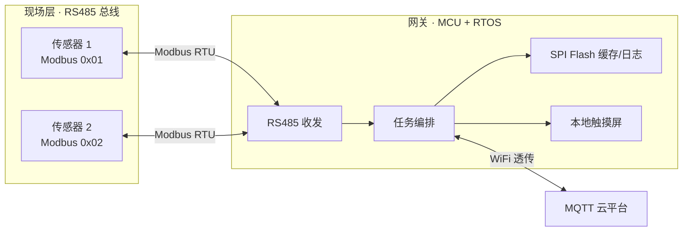
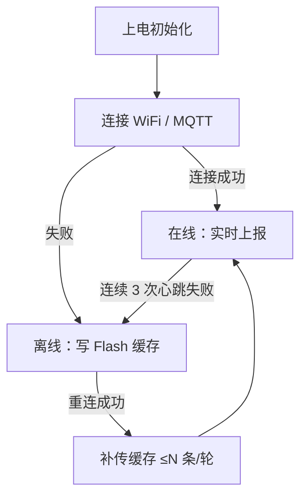

# 工业边缘网关 开发文档

> 本文档为「工业边缘网关」项目的开发文档初始模板。  
> 标注 `> 待填写：` 的段落为需要开发人员补充的内容；已给出表格/图示的可直接沿用或按实际修改。


---

## 文档信息

| 项    | 内容                      |
| ---- | ----------------------- |
| 文档名称 | 工业边缘网关 开发文档             |
| 项目代号 | industrial-edge-gateway |
| 文档版本 | v0.1（初始模板）              |
| 文档状态 | 草稿 / 评审中 / 已发布          |
| 编写人  | 待填写                     |
| 审核人  | 待填写                     |
| 创建日期 | 2026-10-08              |
| 最后更新 | 待填写                     |
| 适用范围 | 待填写（如：固件开发、测试、部署运维）     |
| 密级   | 内部 / 公开                 |

### 修订记录

| 版本   | 日期         | 修订人 | 修订内容 | 备注 |
| ---- | ---------- | --- | ---- | -- |
| v0.1 | 2026-10-08 | 待填写 | 初始模板 |    |

---

## 1. 项目概述

### 1.1 项目背景

> 待填写：项目立项背景、要解决的问题、应用场景（如工业现场环境监测、设备数据上云）。

### 1.2 项目目标

> 待填写：从功能、性能、可靠性、可扩展性等维度描述目标（建议用可衡量的指标）。

- 功能目标：
- 性能目标：（如采集周期、上报延迟、单机接入路数）
- 可靠性目标：（如断网续传、看门狗复位、连续运行时长）

### 1.3 适用范围

> 待填写：本文档覆盖的硬件版本、固件版本、云平台范围，以及不涉及的内容。

### 1.4 名词术语与缩略语

| 术语 / 缩写 | 全称                                   | 说明                    |
| ------- | ------------------------------------ | --------------------- |
| 边缘网关    | Edge Gateway                         | 现场传感器与云端之间的数据汇聚/转发设备  |
| RTU     | Remote Terminal Unit                 | Modbus 串行链路协议         |
| RTOS    | Real-Time Operating System           | 实时操作系统（本项目用 FreeRTOS） |
| LVGL    | Light and Versatile Graphics Library | 嵌入式图形库                |
| OTA     | Over-The-Air                         | 远程固件升级                |
| 待填写     |                                      |                       |

---

## 2. 系统总览

### 2.1 系统简介

> 待填写：一段话概述系统做什么。参考：通过 RS485/Modbus RTU 采集现场传感器数据，经 ESP8266 上报 MQTT 云平台，断网期间用 SPI Flash 环形缓存补传，本地触摸屏实时展示。

### 2.2 系统架构图

> 下图为占位示例（Mermaid），请按实际架构修改。语雀支持 Mermaid 渲染。



### 2.3 数据流说明

> 待填写：按"采集 → 处理 → 存储/上报 → 显示"描述一轮数据的完整流向，说明各环节之间的数据结构与传递方式。

### 2.4 技术栈

| 层次        | 选型                          | 版本  | 说明                           |
| --------- | --------------------------- | --- | ---------------------------- |
| 主控 MCU    | STM32F407ZGT6               | —   | 168MHz，1MB Flash / 128KB RAM |
| RTOS      | FreeRTOS                    | 待填写 |                              |
| GUI       | LVGL                        | 8.3 |                              |
| 加密库 / 协议栈 | 待填写                         |     |                              |
| 云平台       | OneNET / 自建 MQTT            |     |                              |
| 构建工具链     | CMake + GCC (arm-none-eabi) |     |                              |

---

## 3. 硬件设计

### 3.1 硬件框图

> 待填写：主控、外设、接口的框图或说明。

### 3.2 核心器件清单（BOM）

| 位号 | 器件       | 型号                   | 数量 | 说明             |
| -- | -------- | -------------------- | -- | -------------- |
| U1 | 主控       | 待填写（如 STM32F407ZGT6） | 1  |                |
| U2 | 显示       | ILI9341 2.8" 并口屏     | 1  |                |
| U3 | 触摸       | XPT2046              | 1  |                |
| U4 | WiFi     | ESP8266              | 1  |                |
| U5 | 存储       | W25Q128              | 1  | 16MB SPI Flash |
| U6 | RS485 收发 | 待填写                  | 1  |                |

### 3.3 引脚分配表

> 下表已按现有硬件预填，请核对后使用。

| 功能              | 引脚                                                                           | 备注                                     |
| --------------- | ---------------------------------------------------------------------------- | -------------------------------------- |
| LCD FSMC 16 位并口 | NE4=PG12，RS=A12=PG2，NOE=PD4，NWE=PD5，D0~~D15=PD14/15、PD0/1、PD8/9/10、PE7~~PE15 |                                        |
| LCD 背光          | PF10                                                                         | 高=亮                                    |
| XPT2046 触摸      | CLK=PA5，MOSI=PB1，MISO=PB2，CS=PB0，PEN=PF11                                    |                                        |
| ESP8266（WiFi 座） | UART4：TX=PA0，RX=PA1                                                          | 115200；RX=DMA1_Stream2，TX=DMA1_Stream4 |
| RS485           | USART2：PA2/PA3                                                               | 9600；方向脚 PG6（高发低收）                     |
| W25Q128         | SPI1：PB3/4/5                                                                 | 片选 PG8                                 |
| 状态指示灯           | LED0=PE3，LED1=PE4，LED2=PG9                                                   | 低电平亮                                   |
| 调试串口            | UART5：PC12/PD2                                                               | 115200                                 |
| LVGL 心跳         | TIM3 1ms 中断；HAL 时基 = TIM4                                                    | RTOS 下不用 SysTick                       |

### 3.4 外设接口说明

> 待填写：逐个说明外设的用途、工作模式、关键时序或注意事项（如 RS485 方向控制、DMA 空闲接收、FSMC 时序参数）。

### 3.5 电气参数

> 待填写：供电电压/电流、功耗、工作温度范围、接口电平。

### 3.6 硬件版本与变更

| 版本   | 日期  | 变更内容 | 备注 |
| ---- | --- | ---- | -- |
| V1.0 | 待填写 |      |    |

---

## 4. 软件设计

### 4.1 软件架构分层

> 待填写：描述分层（应用层 / 模块层 / 驱动与 HAL 层 / 硬件）及层间依赖规则。

### 4.2 工程目录结构

> 下表为当前工程结构（预填），请按实际修改。

```
Core/                 CubeMX 生成的时钟与外设初始化、FreeRTOS 配置
User/
  app/                任务编排（tasks.c/.h）
  bsp/                板级驱动（lcd.c/.h、touch.c/.h）
  gui/                LVGL 8.3 本体 + porting + ui（界面）
  modbus/             Modbus RTU 主站
  net/                云平台抽象与 MQTT、AT 指令、AT 环形缓冲
  storage/            W25Q128 驱动、补传缓存、系统日志
Drivers/              STM32 HAL 与 CMSIS
Middlewares/          第三方中间件
ModbusSlave/          从机模拟固件（独立工程）
tools/                PC 端模拟/测试脚本
```

### 4.3 任务设计（FreeRTOS）

> 下表为当前任务划分（预填），请核对优先级与周期。

| 任务名      | 优先级 | 栈大小 | 周期    | 职责                 |
| -------- | --- | --- | ----- | ------------------ |
| Modbus   | 待填写 | 待填写 | 800ms | 轮询采集 RS485 传感器     |
| MQTT     | 待填写 | 待填写 | 事件驱动  | 在线实时上报；断网写缓存；重连后补传 |
| AT       | 待填写 | 待填写 | 10s   | 心跳检测与断线重连          |
| UI       | 待填写 | 待填写 | 5ms   | 刷新 LVGL 界面、息屏/唤醒   |
| Dog_task | 待填写 | 待填写 | 3s    | 喂看门狗               |

> 待填写：任务间同步机制（队列、互斥量、信号量）说明。

### 4.4 模块详细设计

#### 4.4.1 采集模块（modbus）

> 待填写：从机配置表、问询帧/应答帧格式、CRC 校验、量程换算规则、超时与重试策略。

#### 4.4.2 存储模块（storage）

> 待填写：Flash 分区划分、环形缓存读写与指针管理、日志环形写入、跨任务互斥保护。

| 分区    | 起始地址     | 大小  | 用途        |
| ----- | -------- | --- | --------- |
| 日志区   | 0x000000 | 4MB | 系统日志（循环写） |
| 补传缓存区 | 0x400000 | 4MB | 断网数据缓存    |

#### 4.4.3 上云模块（net）

> 待填写：云平台 profile 配置、MQTT 建连/订阅/发布、QoS 与 PUBACK 语义、AT 指令交互、断线重连流程。

#### 4.4.4 显示模块（gui / bsp）

> 待填写：界面结构、页面刷新机制、触摸校准、息屏策略、LVGL 绘图对接。

#### 4.4.5 任务编排（app）

> 待填写：各任务启动顺序、共享数据、启停与异常处理。

### 4.5 关键数据结构

> 待填写：列出核心结构体/全局变量及其含义。示例：

```c
typedef struct {
    float   temp;    /* 温度 */
    float   shi;     /* 湿度 */
    float   light;   /* 光照 */
    uint8_t valid;   /* 有效性掩码：bit0=温湿度 bit1=光照 */
} Data_t;
```

### 4.6 状态机 / 运行流程

> 待填写：用流程图或状态表描述关键流程（如"在线/离线状态切换"、"补传流程"）。



### 4.7 全局配置与宏

> 待填写：列出需要按现场调整的配置项（WiFi、云平台地址、凭证、采集周期、超时阈值等）及其所在文件。

| 配置项       | 宏 / 变量       | 所在文件        | 默认值   | 说明 |
| --------- | ------------ | ----------- | ----- | -- |
| WiFi SSID | WIFI_SSID    | net/cloud.h |       |    |
| 云平台选择     | CLOUD_TARGET | net/cloud.h |       |    |
| 采集周期      | —            | app/tasks.c | 800ms |    |

---

## 5. 通信协议

### 5.1 Modbus RTU

> 待填写：链路参数（波特率/数据位/校验/停止位）、支持的功能码、寄存器映射表、异常码处理。

| 从机地址 | 功能码  | 起始寄存器  | 数量 | 数据含义    | 换算               |
| ---- | ---- | ------ | -- | ------- | ---------------- |
| 0x01 | 0x03 | 0x0001 | 2  | 温度 / 湿度 | /10              |
| 0x02 | 0x03 | 0x0002 | 2  | 光照      | (hi<<16|lo)/1000 |

### 5.2 MQTT / 云平台

> 待填写：Broker 地址与端口、ClientID/Username/Password、发布/订阅主题、QoS、KeepAlive、遗嘱消息。

### 5.3 数据格式规范

> 待填写：上/下行报文的 JSON 结构与字段说明。示例：

```json
{
  "temp": 25.6,
  "humi": 58.4,
  "light": 12345,
  "ts": 1730000000
}
```

---

## 6. 接口说明

### 6.1 内部模块接口

> 待填写：各模块对外提供的函数、参数、返回值与调用约束。

| 模块      | 接口                     | 说明     |
| ------- | ---------------------- | ------ |
| modbus  | `Modbus_Poll_AllDev()` | 轮询所有从机 |
| storage | `FlashCache_Write()`   | 写入一条缓存 |
| net     | `cloud_publish()`      | 统一云端发布 |
| storage | `Log_Write()`          | 写系统日志  |

### 6.2 对外接口

> 待填写：对云端、对现场设备、对用户的接口定义。

---

## 7. 构建、烧录与部署

### 7.1 开发环境

> 待填写：IDE、工具链版本、依赖安装步骤。

| 项      | 版本 / 说明                         |
| ------ | ------------------------------- |
| CubeMX | 待填写                             |
| 工具链    | arm-none-eabi-gcc               |
| 构建系统   | CMake                           |
| 下载器    | STM32CubeProgrammer / CMSIS-DAP |

### 7.2 构建流程

```bash
cmake -B build -G Ninja -DCMAKE_TOOLCHAIN_FILE=cmake/gcc-arm-none-eabi.cmake -DCMAKE_BUILD_TYPE=Debug
cmake --build build
arm-none-eabi-objcopy -O binary build/industrial-edge-gateway.elf build/industrial-edge-gateway.bin
```

> 待填写：构建注意事项、产物说明。

### 7.3 烧录

> 待填写：烧录方式、接线、参数、常见失败处理。

### 7.4 现场部署

> 待填写：设备安装、接线、上电顺序、参数配置、首次联调步骤。

---

## 8. 测试与验证

### 8.1 测试环境

> 待填写：测试硬件、工具、模拟器、云平台测试账号。

### 8.2 功能测试用例

| 用例编号   | 测试项   | 前置条件 | 操作步骤        | 预期结果      | 实际结果 | 结论 |
| ------ | ----- | ---- | ----------- | --------- | ---- | -- |
| TC-001 | 上电启动  |      | 上电          | 屏点亮、显示主界面 |      |    |
| TC-002 | 触摸交互  |      | 点按界面        | 响应正常      |      |    |
| TC-003 | 传感器采集 |      | 接 RS485 传感器 | 界面数据刷新    |      |    |
| TC-004 | 断网缓存  |      | 断开网络        | 数据写缓存、灯提示 |      |    |
| TC-005 | 断网补传  |      | 恢复网络        | 缓存自动补传    |      |    |
| 待填写    |       |      |             |           |      |    |

### 8.3 性能测试

> 待填写：采集响应时间、上报延迟、刷屏帧率、内存占用等指标与实测值。

### 8.4 可靠性 / 长跑测试

> 待填写：连续运行时长、看门狗验证、断电续传、异常恢复测试结果。

### 8.5 验收标准

> 待填写：明确通过/不通过的判定条件。

---

## 9. 调试指南

### 9.1 调试手段

| 手段    | 出口 / 位置                                 | 说明      |
| ----- | --------------------------------------- | ------- |
| 调试打印  | `dbg_print()` → UART5 (PC12/PD2) 115200 | 关键事件    |
| 系统日志  | `Log_Write()` → W25Q 日志区                | 界面日志页可查 |
| 状态指示灯 | LED0=PE3，LED1=PE4，LED2=PG9              | 低电平亮    |
| 在线调试  | SWD                                     | 断点、变量监视 |

> 待填写：其余调试技巧与工具。

### 9.2 常见问题排查

| 现象    | 可能原因         | 排查方法                | 解决方案 |
| ----- | ------------ | ------------------- | ---- |
| 屏幕花屏  | 颜色字节序配置错误    | 检查 LV_COLOR_16_SWAP |      |
| 高负载跑飞 | Flash 等待周期不足 | 检查 FLASH_LATENCY    |      |
| 待填写   |              |                     |      |

### 9.3 已知问题与待办

| 编号        | 描述  | 影响 | 状态              | 计划 |
| --------- | --- | -- | --------------- | -- |
| ISSUE-001 | 待填写 |    | 未解决 / 处理中 / 已解决 |    |

---

## 10. 运维与升级

### 10.1 日志查看

> 待填写：日志获取方式、字段含义、常见日志解读。

### 10.2 固件升级（OTA / 本地）

> 待填写：升级方式、流程、失败回滚策略。

### 10.3 故障处理

> 待填写：常见故障的现场处置流程。

---

## 附录

### A. 引脚速查表

> 见 3.3，可在此处再列一版精简表或省略。

### B. Flash 分区表

> 见 4.4.2。

### C. 参考资料

> 待填写：芯片手册、工具链文档、云平台文档、项目仓库链接等。

### D. 变更历史

> 待填写：与文档修订记录区分，此处记录设计/实现的重大变更。
