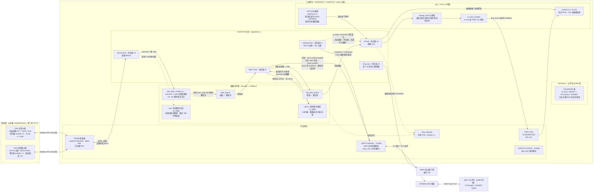
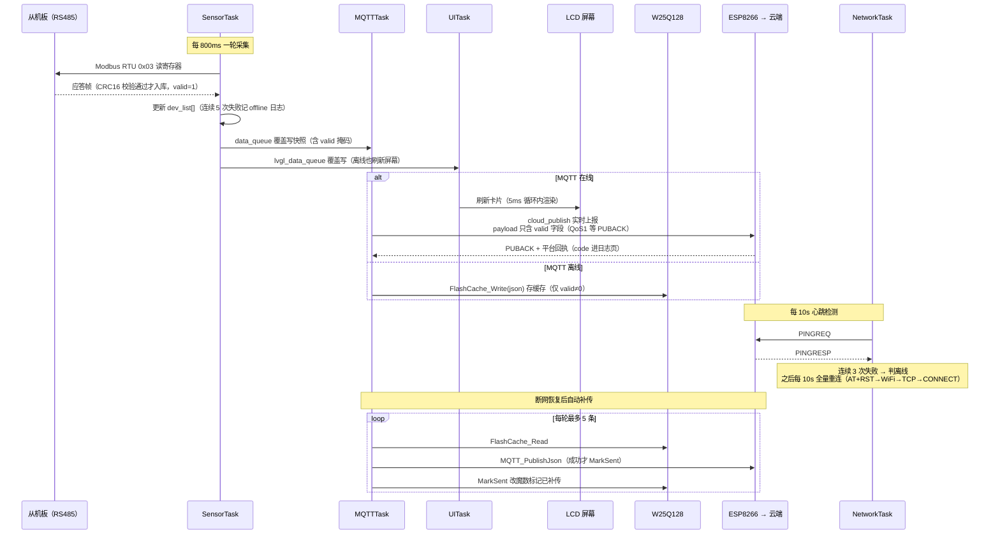

# 工业边缘网关 · 系统架构与数据流

基于 STM32F407 + FreeRTOS + LVGL v8 的工业边缘网关：通过 RS485/Modbus RTU 采集**从机板**（DHT11 实测温湿度 + 光敏 ADC 光照）数据，经 ESP8266 上报 MQTT 云平台（IOTSystem / OneNET，profile 切换），断网期间用 W25Q128 环形缓存补传；本地 2.8 寸触摸屏实时展示，W25Q128 同时存系统循环日志。

## 系统架构与数据流

## 一次采集 → 上云 → 显示的时序

## 关键机制说明

- **数据有效性门控**：`dev_list[]` 每台设备带 `valid` 标志（首次成功读到数据置位）。payload 只包含 valid 字段；全无效时不上报、不进断网缓存——**全 0 假数据永远不会上云**。
- **并发保护（两把锁）**：`esp_uart_mutex` 串行化 UART4（ESP8266）；`flash_mutex`（w25qxx 层持有）串行化 W25Q128——日志（AT/MQTT/UI 任务）、缓存（MQTT 任务）、触摸校准（UI 任务）跨任务共用同一颗芯片，防止 SPI 事务被抢占打断。两个队列都是容量 1 覆盖写，消费者永远拿最新值。
- **失败语义**：Modbus 应答超时/CRC 错 → 本轮丢弃，`dev_list` 保持上次值；连续 5 次失败记 `modbus 0x0X offline`、恢复记 `back online`（日志页 + 串口可见）。云端断链 = 3 次心跳失败（约 30s）判离线，之后每 10s 全量重连（AT+RST 清干净模块半死状态）。
- **息屏**：UITask 里 10 秒无触摸/无数据跳变 → 关背光（PF10）；唤醒只认触摸（唤醒那一次按压被 `lv_indev_wait_release` 吞掉，不误触按钮）；传感器数值跳变（>3°C / >3%RH / >10lx）也会亮屏，但**云状态变化只刷新显示不亮屏**（RS485 插拔、状态翻转本身不点亮屏幕）。
- **云端发布统一走 profile 层**：`cloud.c` 的 `CloudProfile` 表收敛服务器/MQTT 版本（MQIsdp v3.1 vs MQTT v3.1.1）/认证/主题/QoS 差异，CONNECT 报文动态拼装；业务层只调 `cloud_build_payload()` + `cloud_publish()`。QoS1 平台以 PUBACK 为成功，发布后解析平台回执（`code` 写进日志页：0=成功，10411=物模型标识符不符）。
- **看门狗**：IWDG 溢出 10s，Dog_task 每 2.5s 检查全部任务心跳正常才喂；任何任务卡死（如 configASSERT 关中断挂死、UI 白屏、Modbus 停采）都会触发整机复位。
- **调试串口**：UART5（PC12/PD2，115200）输出联网阶段事件、OneNET 回执，并镜像全部日志（`[LOG]` 前缀）；与屏幕日志页内容一致。

## 关键参数速查

| 项 | 值 |
|---|---|
| RS485/Modbus | USART2，9600-8N1，方向脚 PG6；从机 0x01 温湿度（DHT11）、0x02 光照（ADC） |
| 从机板 | 独立工程 `ModbusSlave/`：DHT11=PG9（2s 采样）、光敏=PF7 ADC3_CH5（换算 0~20000 lx，IIR 滤波）|
| ESP8266 | UART4，115200，PA0/PA1，DMA 空闲接收（RX=Stream2，TX=Stream4）|
| 云平台 profile | `net/cloud.h` 的 `CLOUD_TARGET`：IOTSystem（自建，局域网 1883，pk+secret）/ OneNET Studio（mqtts.heclouds.com:1883，token，`et=` 到期需重生成，默认）|
| SPI Flash | **W25Q128，总容量 16MB**（JEDEC EF4018），SPI1（PB3/4/5），CS=PG8 |
| W25Q 分区 | 日志 0~4MB（log.c）；补传缓存 4~8MB（cache.c）；触摸校准参数 0xF00000（1 扇区）；**8~16MB 除参数页外空闲可扩展** |
| W25Q 访问保护 | `flash_mutex` 全芯片互斥 + `w25qxx.c` 上电清 BP 块保护位（自愈）|
| LCD | ILI9341 320×240 横屏，FSMC NE4 16 位并口，背光 PF10，MADCTL=0x68（MX|MV 横屏 + **BGR=1**，此面板实测需 BGR 位）|
| 触摸 | XPT2046，GPIO 模拟 SPI（PA5/PB0/PB1/PB2），PEN=PF11；两点校准持久化 0xF00000 |
| 采集周期 | 800ms（设备间隔 30ms） |
| MQTT 心跳 | 10s，连续 3 次失败判离线 |
| 补传策略 | 断网存 cache.c（W25Q 4~8MB），重连后每轮 ≤5 条，PUBACK 确认才标记已发 |
| 系统日志 | log.c（W25Q 0~4MB 循环日志），条目 76B 不跨扇区，进扇区先擦除 |
| UI 刷新 | 5ms 循环调 lv_timer_handler，lv_tick 由 TIM3 提供（PSC=99/ARR=999 @84MHz，实际 ≈1.19ms；1ms 为设计意图，见已知问题）；HAL 时基 = TIM4 |
| 调试串口 | UART5 PC12/PD2 115200（dbg_print + 日志镜像）|

## 已知问题 / 待办

1. **云端下行未处理**：IOTSystem/OneNET 的 `cmd/<id>/exec`、`property/set` 已订阅，透传流里已有回执解析器（`mqtt_drain_downlink`）但还没有把平台指令派发执行的表驱动（上报链路已完成）。
2. **Modbus 连续失败不跳过设备**：故障设备每轮仍全量问询（800ms/台 白等超时）；已有 offline/online 日志，跳过逻辑（`MAX_ERR_CNT`）留作可选优化。
3. **触摸校准强制重校入口**：已实现"按住屏幕开机"触发；如需运行中入口（如设置页长按）另行添加。
