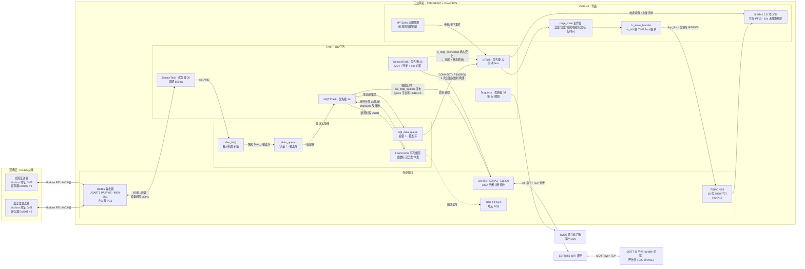
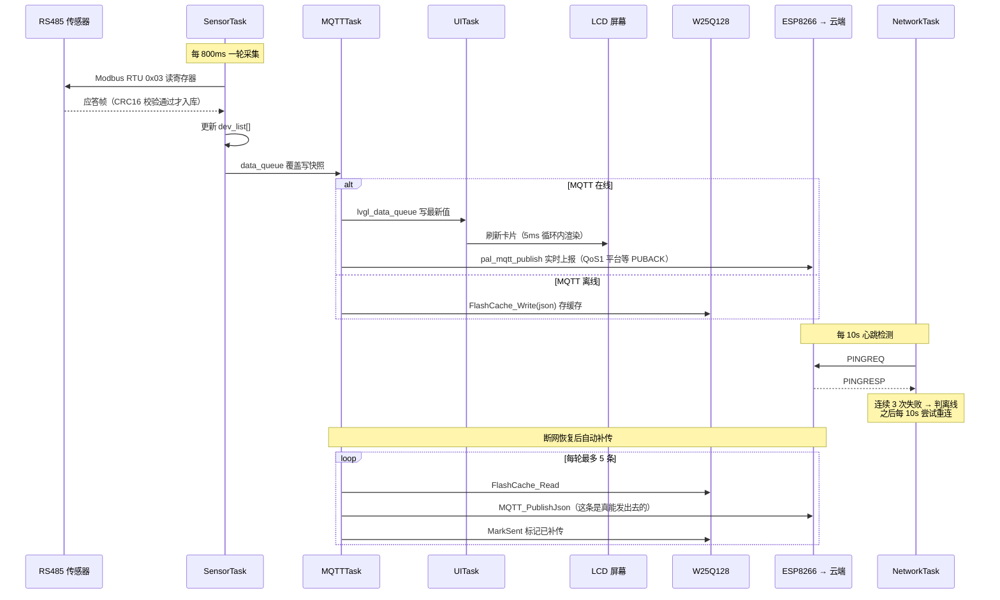

# 工业边缘网关 · 系统架构与数据流

基于 STM32F407 + FreeRTOS + LVGL v8 的工业边缘网关：通过 RS485/Modbus RTU 采集现场传感器数据，经 ESP8266 上报 MQTT 云平台，断网期间用 SPI Flash 环形缓存补传；本地 2.8 寸触摸屏实时展示。

## 系统架构与数据流

## 一次采集 → 上云 → 显示的时序

## 关键机制说明

- **并发保护**：UART4（ESP8266）被 NetworkTask 和 MQTTTask 共用，靠 `uart1_mutex` 互斥；两个队列都是容量 1 的覆盖写（`xQueueOverwrite`），消费者永远拿到最新值，不积压。
- **失败语义**：Modbus 某台设备应答超时/CRC 错 → 本轮丢弃，`dev_list` 保持上一次的值（错误计数逻辑目前被注释掉）；UI 和云端不会看到跳变，设备真离线时数值会"冻结"。
- **息屏**：UITask 里 10 秒无触摸关背光（PF10），触摸唤醒；唤醒的那次按压会被吞掉，不会误触按钮。
- **云端发布统一走 profile 层**：`pal.c` 的 `CloudProfile` 表收敛了服务器/MQTT 版本/认证/主题/QoS 差异，业务层只调 `pal_mqtt_build_payload()` + `pal_mqtt_publish()`；QoS1 平台以收到 PUBACK 为成功，断网补传也仅在发送成功后标记已发。
- **看门狗**：IWDG 溢出 20s，Dog_task 每 3s 喂一次；任何任务卡死（如 configASSERT 关中断挂死）都会触发整机复位。

## 关键参数速查

| 项 | 值 |
|---|---|
| RS485/Modbus | USART2，9600-8N1，方向脚 PG6；从机 0x01 温湿度、0x02 光照 |
| ESP8266 | UART4，115200，PA0/PA1，DMA 空闲接收 |
| 云平台 profile | `pal.h` 的 `CLOUD_TARGET`：巴法云（默认）/ E2（192.168.x:1883，pk+secret）/ OneNET Studio（mqtts.heclouds.com:1883，token）|
| SPI Flash | W25Q128，SPI1（PB3/4/5），片选 PG8 |
| LCD | ILI9341 320×240 横屏，FSMC NE4 16 位并口，背光 PF10 |
| 触摸 | XPT2046，GPIO 模拟 SPI（PA5/PB0/PB1/PB2），PEN=PF11 |
| 采集周期 | 800ms（设备间隔 30ms） |
| MQTT 心跳 | 10s，连续 3 次失败判离线 |
| 补传策略 | 断网存 FlashCache，重连后每轮 ≤5 条 |
| UI 刷新 | 5ms 循环调 lv_timer_handler，lv_tick 由 TIM3 1ms 提供 |

## 已知问题 / 待办

1. **云端下行未处理**：E2/OneNET 的 `cmd/<id>/exec`、`property/set` 已订阅，但透传流里还没有 MQTT 报文分发器把平台指令解析执行（上报链路已完成，分发器按 pal.c 预留的 profile 结构加表驱动即可）。
2. **Modbus 错误计数被注释**：`Modbus_Poll_AllDev()` 里连续失败跳过设备的逻辑（`MAX_ERR_CNT`）当前失效，故障设备每轮都会白等超时（800ms/台）。
